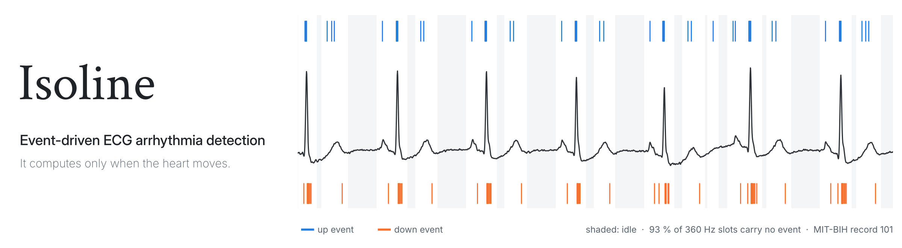
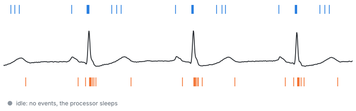
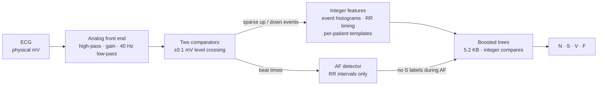
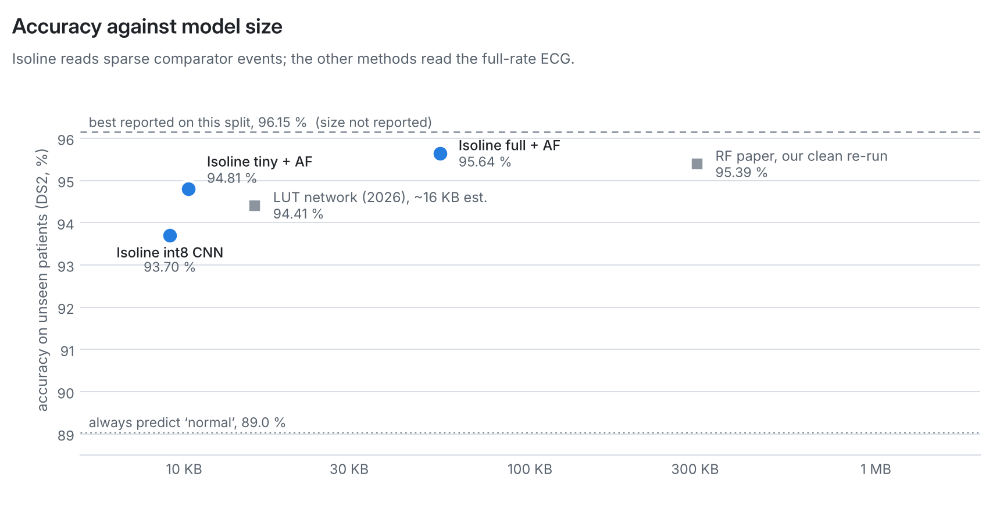
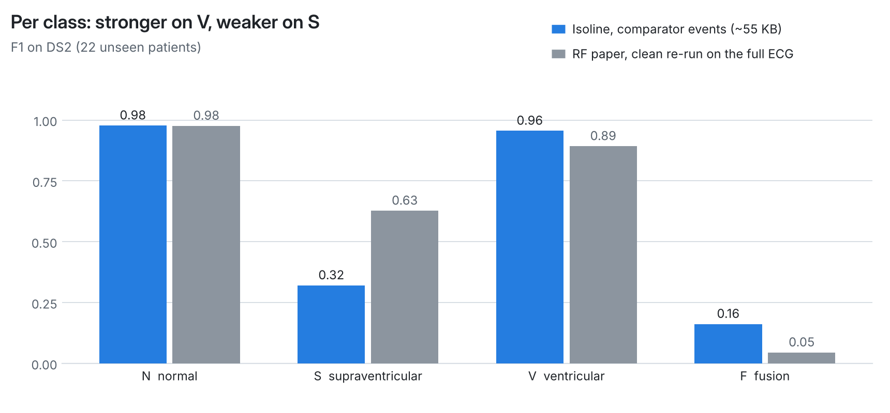
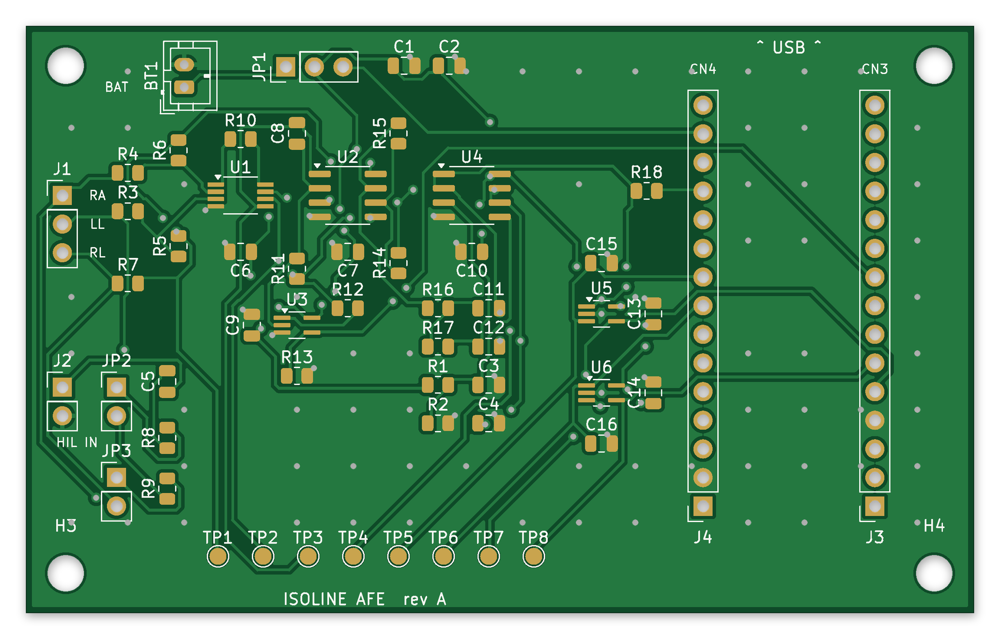
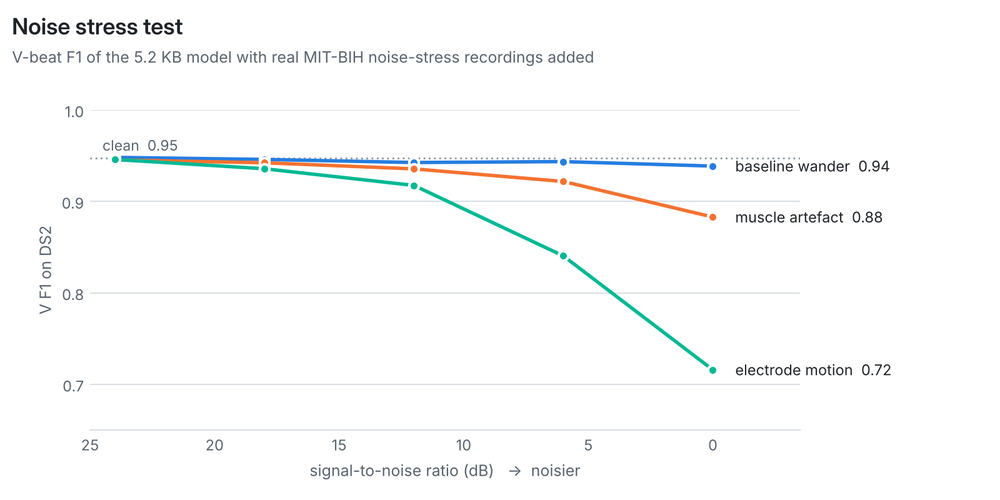
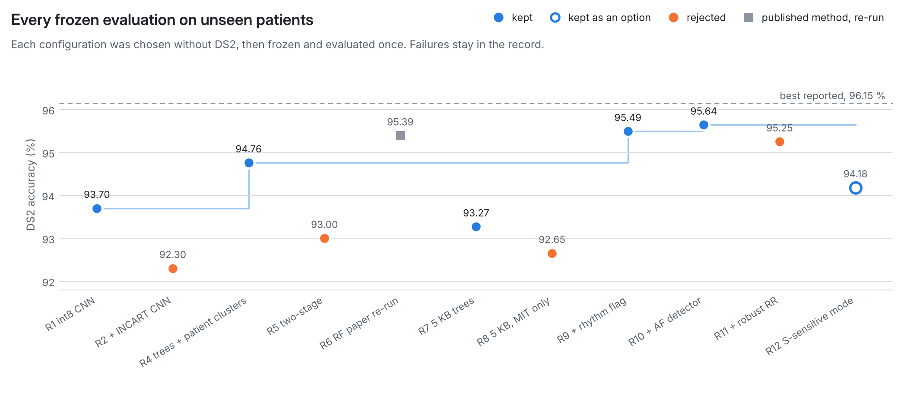

<picture>
  <source media="(prefers-color-scheme: dark)" srcset="docs/img/hero_dark.png">
  
</picture>

<p align="center">
  <a href="#results">Results</a> &nbsp;·&nbsp;
  <a href="#how-it-works">How it works</a> &nbsp;·&nbsp;
  <a href="#from-simulation-to-silicon">Hardware</a> &nbsp;·&nbsp;
  <a href="#method">Method</a> &nbsp;·&nbsp;
  <a href="#reproduce">Reproduce</a>
</p>

<br>

An ECG spends most of its time on the flat **isoelectric line**. Isoline does not sample it. Two comparators emit an
*up* or *down* event whenever the signal moves by 0.1 mV, so a quiet baseline produces nothing and the processor sleeps.
Each heartbeat becomes a short burst of events, which a few-kilobyte tree model turns into one of the four AAMI classes:
**N**ormal, **S**upraventricular, **V**entricular or **F**usion.

<div align="center">
<picture>
  <source media="(prefers-color-scheme: dark)" srcset="docs/img/isoline_live_dark.gif">
  
</picture>
</div>

<br>

| 95.6 % | 5.2 KB | ~90 % | 0.96 |
|:--:|:--:|:--:|:--:|
| accuracy on unseen patients | the tiny classifier | of the time with no events | V-beat F1 |
| <sub>MIT-BIH inter-patient split</sub> | <sub>94.8 % with the AF detector</sub> | <sub>front end and compute stay quiet</sub> | <sub>above a clean re-run of the best published method</sub> |

<br>

## How it works



| Stage | What it does | Why it is cheap |
|---|---|---|
| Level crossing | two comparators and a DAC replace the ADC | about 55 events per second; nothing at all on a flat line |
| Event features | 32-bin up/down histograms around each beat, gain-normalised | counters and shifts |
| Patient adaptation | a running template and four online clusters of *this* patient's beat shapes | about 800 bytes of state, strictly causal |
| Rhythm | RR ratios over short and long memory, plus an RR-only AF/flutter detector | one timer and a few divides per beat |
| Classifier | gradient-boosted trees whose every split is an integer comparison | about 840 compares per beat |

## Results

All numbers are on **DS2**: 22 patients never seen in training, under the standard de Chazal inter-patient protocol.

<picture>
  <source media="(prefers-color-scheme: dark)" srcset="docs/img/size_vs_accuracy_dark.png">
  
</picture>

| Model | Input | Size | Accuracy | V F1 | S F1 |
|---|---|--:|--:|--:|--:|
| **Isoline, full + AF detector** | comparator events | ~55 KB | **95.64 ± 0.04 %** | **0.956** | 0.32 |
| **Isoline, tiny + AF detector** | comparator events | **5.2 + 5.1 KB** | 94.81 ± 0.04 % | 0.947 | 0.32 |
| Isoline, int8 CNN | comparator events | 9 KB | 93.7 ± 0.4 % | 0.89 | 0.17 |
| RF paper ([Saenz-Cogollo & Agelli 2020](https://doi.org/10.3390/a13040075)), our clean re-run | full-rate ECG | ~300 KB | 95.39 ± 0.09 % | 0.89 | 0.63 |
| LUT / logic-gate networks (2026 preprint) | full-rate ECG | ~16 KB (est.) | 93.6–94.4 % | ≤ 0.91 | 0.01–0.47 |
| Best reported on this split | full-rate ECG | not reported | 96.15 % | 0.94 | 0.69 |

<picture>
  <source media="(prefers-color-scheme: dark)" srcset="docs/img/per_class_dark.png">
  
</picture>

> [!NOTE]
> **Strong on ventricular beats, weak on supraventricular ones.** V beats carry the clearest morphology and need no
> P-wave. S beats that are *not* premature can only be told apart by P-wave shape. Even a full-resolution P-wave
> did not help with the little training data available for them (DS1 has 268 such beats, almost all from two
> patients), so the blind spot is a data limit, not only a front-end one.
> An optional **S-sensitive mode** raises S sensitivity from 22 % to 37 % for 0.6 points of accuracy.
> [Details](docs/EXPERIMENTS.md)

## From simulation to silicon

The same model is carried through every stage of the hardware chain. Each stage is measured on DS2 with nothing re-tuned.

| Stage | What runs | DS2 result |
|---|---|---|
| Python front-end model | the reference pipeline (0.05 Hz high-pass, as in the circuit) | 95.51 % full · 94.76 % tiny |
| ngspice circuit | records passed through the simulated analog front end (INA333, servo, gain, Sallen-Key filter) | 95.50 % full · 94.74 % tiny |
| Firmware, virtual hardware-in-the-loop | the **unmodified STM32L432 firmware** (interrupts, DAC thresholds, streaming features, int8 trees) against simulated comparators and DAC | **93.49 % end-to-end**, missed beats counted as errors; beat detection Se 99.69 %, +P 99.08 % |
| Printed circuit board | rev A carrier for a Nucleo-L432KC, 84 × 52 mm, 2 layers, routed and DRC-clean | Gerbers ready; not yet built |

<div align="center">

<br><sub>Rev A, top side. The analog chain runs left to right into the comparators; the Nucleo-32 plugs into the two sockets on the right.</sub>
</div>

<br>

The analog front end draws about **110–170 µW** ([power budget](hardware/POWER_BUDGET.md)). The firmware fits in 66 KB of
flash and 25 KB of RAM on the STM32L432KC, and its features are **bit-exact** with the Python reference.
See [`hardware/`](hardware) for the circuit, simulation and PCB, and [`firmware/`](firmware) for the code.

## Robustness

<table>
<tr>
<td width="56%">
<picture>
  <source media="(prefers-color-scheme: dark)" srcset="docs/img/noise_dark.png">
  
</picture>
</td>
<td>

**Cross-database**, trained once and never tuned:

| Database | Accuracy | V Se |
|---|--:|--:|
| MIT-BIH Supraventricular | 90.3 % | 0.92 |
| European ST-T | 94.8 % | 0.85 |
| MIT-BIH Long-Term | 92.6 % | 0.90 |
| Normal Sinus Rhythm | 99.4 % | – |

Baseline wander is harmless; electrode motion below about 6 dB is the hard case. False alarms on other databases
(4–7 % of normal beats) remain the open problem.

</td>
</tr>
</table>

## Method

<picture>
  <source media="(prefers-color-scheme: dark)" srcset="docs/img/journey_dark.png">
  
</picture>

Every configuration was chosen on DS1 or on other databases, then frozen, then evaluated on DS2. Ideas that looked good
in development and failed on unseen patients stay in the record. DS2 has been evaluated **14 times** over the project,
always with frozen configurations. That count is disclosed because it makes any comparison slightly optimistic.
The full lab notebook is [`docs/EXPERIMENTS.md`](docs/EXPERIMENTS.md); the locked configuration (model v1.0) is
described in [`docs/STATUS.md`](docs/STATUS.md).

<details>
<summary><b>Research-integrity rules</b></summary>
<br>

- DS2 is the test set. It is never used for tuning, feature choice, thresholds or early stopping.
- Splits are by **patient**. Extra databases (INCART, SVDB, AFDB, LTDB) are training or development data only.
- Inputs are in physical millivolts with no per-beat normalisation, because real comparators see real volts.
- Features are causal.
- Results are reported as mean ± std over seeds, and negative results are kept.
- Published baselines are re-run under the same protocol before any comparison.
</details>

## Reproduce

```bash
pip install -r requirements.txt
python scripts/download_data.py --only mitdb svdb      # PhysioNet
python -m pytest -q tests                              # hardware-exact feature logic

python scripts/final_af_detector.py data/mitdb data/incart data/afdb data/cache results   # headline result
python scripts/export_c.py data/mitdb data/incart data/afdb data/cache                     # C export + bit-exact check
python firmware/stm32/sim/hil_run.py data/mitdb DS2 hil.json                               # firmware in the loop
python scripts/make_readme_figures.py --data-dir data/mitdb                                # these figures
```

<details>
<summary><b>Repository map</b></summary>
<br>

| Path | Contents |
|---|---|
| [`isoline/`](isoline) | front-end and level-crossing model, hardware-exact integer features, dataset pipeline |
| [`scripts/`](scripts) | every experiment, the final evaluations, C export, figures |
| [`export/`](export) | the generated C model |
| [`firmware/`](firmware) | portable C core (bit-exact) and the STM32L432 application with its virtual HIL |
| [`hardware/`](hardware) | design values, ngspice simulation, KiCad schematic, PCB and fabrication files |
| [`results/`](results) | JSON results and logs behind every claim in this README |
| [`docs/`](docs) | the experiment log and the project status |
</details>

<br>

<p align="center"><sub>
The isoelectric line is the flat baseline of an ECG, the part Isoline refuses to spend energy on.<br>
MIT License · a research prototype, not a medical device.
</sub></p>
