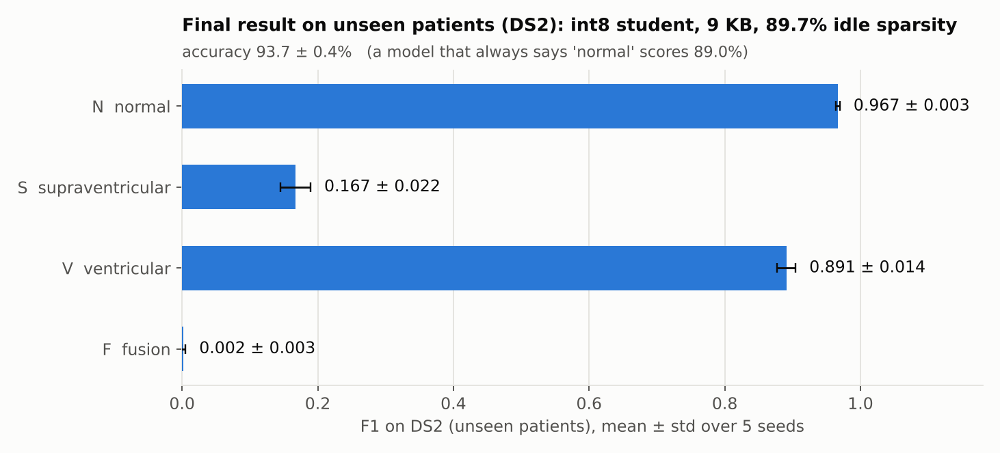
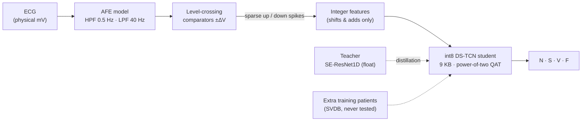
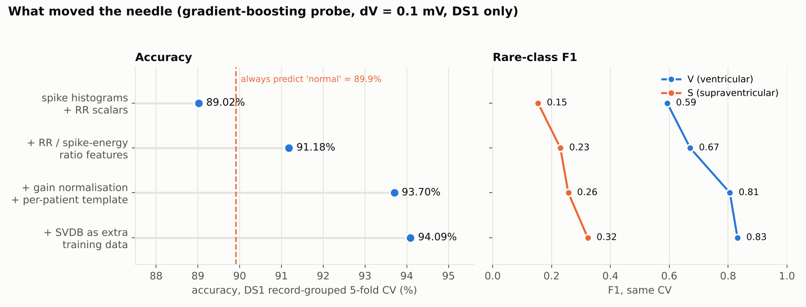
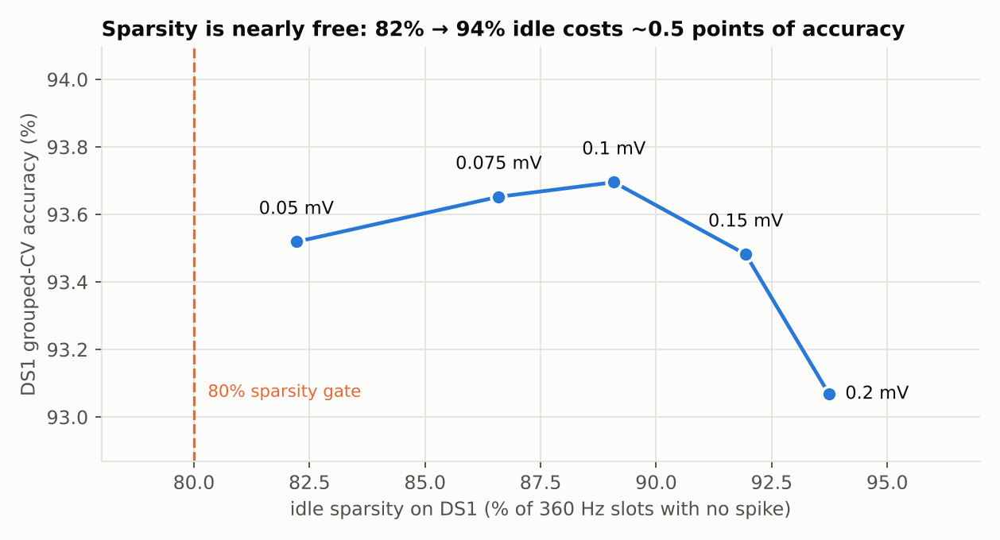

<div align="center">

# 〰️ Isoline

**Event-driven ECG arrhythmia inference — compute stays asleep while the heart sits on its baseline.**

[](https://www.python.org/)
[](https://physionet.org/)
[](docs/STATUS.md)
[](LICENSE)



</div>

---

## The idea

An ECG is mostly **nothing**. Between the QRS complexes the signal sits on the *isoelectric line* — the flat baseline —
for well over 80 % of every heartbeat. Conventional edge-AI runs a dense, frame-based network continuously across all of
it.

**Isoline** asks: what if a heartbeat is only *computed* when the signal actually moves?

A nanopower analog front end feeds a pair of **level-crossing comparators** that emit an `up` / `down` spike whenever
the conditioned ECG moves by ±ΔV. On a flat baseline there are no spikes, so nothing downstream needs a clock. When a
QRS arrives, a burst of spikes is turned into a small, **hardware-exact integer feature vector** and classified by a
**9 KB int8 network**.

> Why “Isoline”? The *isoelectric line* is the flat baseline of an ECG — exactly the part we refuse to spend energy on.

This repository is the **Python proof-of-concept** that answers the first question honestly: *how much accuracy do we
keep when the signal is reduced to sparse spikes, and what does it cost in sparsity and model size?*

## How it works



| Stage | What it does | Hardware-friendly because… |
|---|---|---|
| **AFE emulation** | Causal 1st-order HPF + 2nd-order LPF, then a delta modulator (±ΔV) | models the INA333 → comparator chain; no look-ahead |
| **Spike histograms** | 32-bin temporal histograms of up/down spikes over a 256-sample beat window | 8-bit saturating counters |
| **Leaky integrator** | 12-bit state, 8-bit output, sign-magnitude decay (`acc -= acc >> 4`) | one adder and a shifter |
| **Causal RR timing** | Q3.5 fixed point (1 s = 32 counts), EWMA by shifts, ratios | tiny timer + one divide per beat |
| **Gain adaptation** | Histograms shifted by a priority-encoder on the spike-energy EWMA | removes patient-to-patient amplitude bias |
| **Per-patient template** | Running average of *this patient's* recent normal beats; model sees `beat − template` | strictly causal, 96 small registers |
| **Student** | Dilated depthwise-separable TCN, BN folded, int8, power-of-two scales | every requantisation is a shift |

## Results

Everything below is **inter-patient**: train on DS1 patients, test on completely unseen DS2 patients (De Chazal split,
MIT-BIH, AAMI classes, paced records excluded).

### Final result (5 seeds, DS2 evaluated once per seed on a frozen config)

| | Accuracy | S F1 | V F1 | F F1 |
|---|---|---|---|---|
| Teacher (float, dense window) | 87.9 ± 2.0 % | 0.10 | 0.71 | 0.02 |
| Student (float) | 93.2 ± 0.8 % | 0.20 | 0.89 | 0.00 |
| **Student (int8 QAT, 9,072 B)** | **93.7 ± 0.4 %** | **0.17 ± 0.02** | **0.89 ± 0.01** | **0.00** |

**89.7 % idle sparsity** (≈ 55 spikes/s on average) at ΔV = 0.1 mV.

### What moved the needle



The biggest single gain came from the **causal per-patient template**: judging each beat against that patient's own
recent normal beats lifted DS1 grouped-CV accuracy from ~91 % to 93.7 %. Adding a second database purely as extra
*training* data (SVDB) lifted `S` F1 from 0.26 to 0.32.

### Sparsity is nearly free



Raising ΔV from 0.05 to 0.2 mV pushes idle sparsity from 82 % to 94 % for roughly half a point of accuracy.

## Honest assessment

This is a working baseline, **not a state-of-the-art result**.

* ✅ Sparsity target met cheaply; 9 KB model; reproducible, leak-free, stable across seeds.
* ✅ `V` (ventricular) detection is decent (F1 ≈ 0.89).
* ❌ **`S` is weak** (F1 ≈ 0.17, sensitivity ≈ 0.11) and **`F` is essentially not detected.**
* ❌ Accuracy 93.7 % misses the 95.5 % target. For scale: about 89 % of DS2 beats are normal, so *always predicting
  “normal” already scores 89.0 %*. Per-class F1 is the number to watch.
* ❌ The distillation teacher is **worse** than the student; it is not yet pulling its weight.

**Negative results we kept:** a one-beat decision delay (using the *next* RR interval) barely helps
(93.70 → 93.75 %) and breaks causality, so it is off by default; extra RR-history features didn't help either.

**Open question that matters most:** the original thesis that *clock-gating the inference burst saves power* is
**unproven** — on an FPGA, static idle power dwarfs compute energy. The compute platform is intentionally undecided
until this PoC is finished. See [`docs/STATUS.md`](docs/STATUS.md).

## Where the ceiling is (and what did not move it)

Credible published inter-patient results on the same De Chazal split top out around **96.1–96.2 % accuracy**
(S F1 ≈ 0.69, V F1 ≈ 0.94; e.g. a weighted kernel ELM and a 6-feature random forest). Much higher numbers in the
literature (98–99 %) come from intra-patient / random-beat splits, one-vs-rest "accuracy", or are unverified, and are
**not comparable**. Those methods use full-rate waveforms and large models; Isoline sees only sparse level-crossing
events and fits in 9 KB, so we are about 2.4 points below that ceiling on accuracy and far below it on S.

Round 2 of experiments (DS1 grouped CV only, DS2 untouched; full table in
[`results/exp_ideas_log.txt`](results/exp_ideas_log.txt)):

| Idea | DS1 CV accuracy | Verdict |
|---|---|---|
| baseline | 93.70 % | — |
| per-class score scaling (nested CV) | 92.72 % | worse |
| second ECG lead | 93.74 % | no gain |
| dense raw waveform instead of spikes | 92.94 % | worse: spikes + template carry the signal |
| rhythm-irregularity / previous-beat features | 93.71–93.75 % | within noise |
| multi-scale ΔV (0.05 + 0.1 + 0.2 mV) | 93.59 % | no gain |
| full SVDB for the neural student | ≈93.1 % (1 seed, dev hold-out) vs 94.8 % without | worse, not adopted |

Takeaway: with these hardware-feasible features the DS1 estimate saturates near 93.7–94 %. The S misses are concentrated
in a handful of records (e.g. 209) and the false alarms in noisy ones (e.g. 203), so more feature engineering on the
same signal is unlikely to close the gap; likely levers are more diverse training patients and per-beat morphology
detail that the sparse encoding discards.

## Research integrity

* **DS2 is the test set — never used for tuning.** ΔV, features, loss and early stopping are all chosen on DS1
  (record-grouped CV or a record-wise hold-out). `train_student.py` only touches DS2 with an explicit `--final`.
* **No patient leakage.** Splits are by record; extra databases are training data only.
* **Physical millivolts, no per-window z-score** — real comparators work on fixed voltage thresholds.
* **Causal features only** (pre-RR; no look-ahead beyond the beat window).
* **Seeds and error bars**, not best-of-N.
* **Disclosure:** the very first sweep looked at DS2 when picking ΔV = 0.1 mV. It was re-derived on DS1 only and agrees;
  the old files live in [`results/archive_first_run/`](results/archive_first_run) and should not be cited.

## Quick start

```bash
pip install -r requirements.txt
python -m pytest -q tests                      # 9 tests on the integer feature logic
python scripts/download_data.py --only mitdb svdb

# 1) pick the level-crossing step on DS1 only
python scripts/select_delta.py --data-dir data/mitdb

# 2) develop on DS1 validation (DS2 is not even loaded)
python scripts/train_student.py --delta 0.1 --svdb-dir data/svdb --seeds 0

# 3) final, frozen-config evaluation on DS2
python scripts/train_student.py --delta 0.1 --svdb-dir data/svdb --seeds 0 1 2 3 4 --final

python scripts/make_figures.py                 # regenerate the plots above
```

**GPU (e.g. RTX 50-series, Blackwell):** install a CUDA 12.8+ build — `pip install torch --index-url
https://download.pytorch.org/whl/cu128`. `train_student.py` picks CUDA automatically. Installing `numba` makes the
feature loops ~50× faster.

## Repository map

| Path | Purpose |
|---|---|
| [`isoline/`](isoline) | library: `afe.py`, `features.py` (integer feature logic), `pipeline.py`, `models.py`, `quant.py`, `data.py` |
| [`scripts/`](scripts) | download, ΔV selection, training, diagnostics, SVDB experiment, figures |
| [`tests/`](tests) | unit tests for the hardware-exact parts |
| [`results/`](results) | final JSON/logs, DS1 experiments, per-seed checkpoints, archived first run |
| [`docs/STATUS.md`](docs/STATUS.md) | **where we left off and what to do next** |
| [`docs/HANDOFF_original.md`](docs/HANDOFF_original.md) | the original project brief |

## Roadmap

- [x] Dataset loader in physical mV, 360 Hz timebase, leak-free De Chazal split
- [x] AFE emulation + level-crossing encoder, ΔV selection on DS1 only
- [x] Hardware-exact integer features (+ per-patient template, gain normalisation)
- [x] Distilled int8 student with BN folding and power-of-two QAT, multi-seed evaluation
- [x] Extra training data (SVDB) shown to help `S` in DS1 CV
- [ ] Re-train the deep student with SVDB on GPU and re-run the frozen DS2 evaluation
- [ ] Fix the teacher; ablation table; size sweep; tree-ensemble baseline
- [ ] Literature baselines re-run under the same split; cross-dataset test
- [ ] Energy-per-beat estimate vs a duty-cycled MCU → **then** choose the compute platform
- [ ] Integer reference forward + `.hex` export, then hardware (custom PCB, designed by hand)

## License

MIT — see [`LICENSE`](LICENSE).
