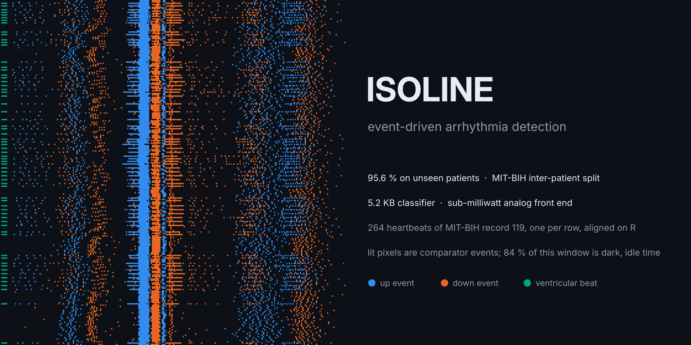
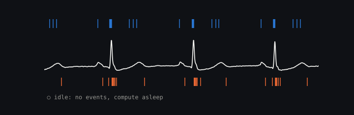
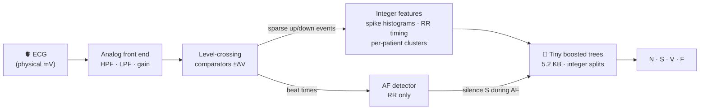
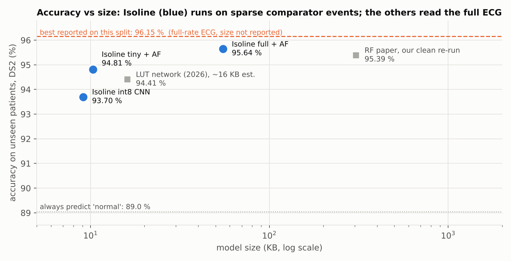
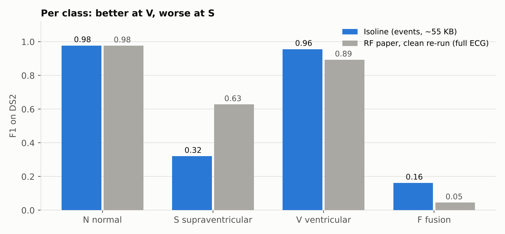
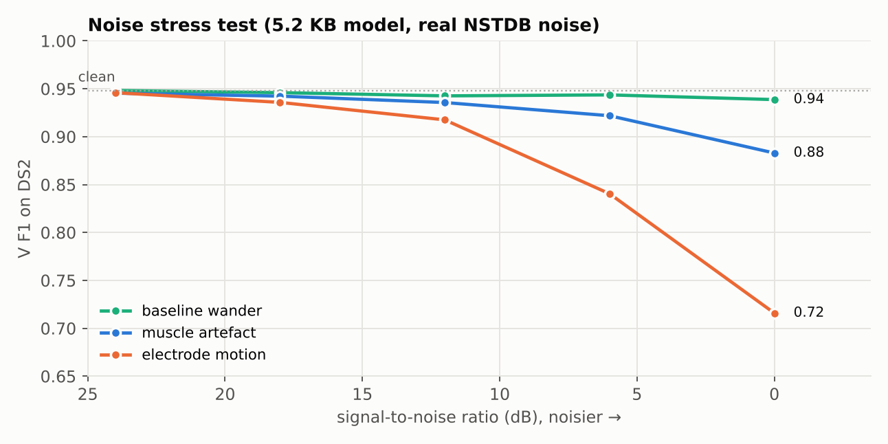
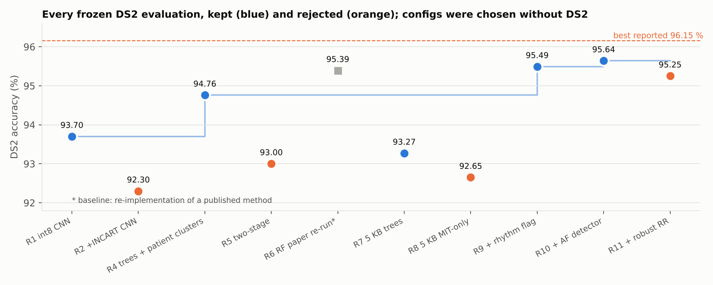

<div align="center">



### A heartbeat classifier that sleeps through the flat parts of your ECG.

[](https://www.python.org/)
[](#-results)
[](#-results)
[](#-how-it-works)
[](export/)
[](LICENSE)

</div>

---

## ✨ The idea in one picture

<div align="center">

</div>

An ECG sits on its flat **isoelectric line** most of the time. Isoline does not sample it.
Two comparators emit an **up** or **down** event whenever the signal moves by ±0.1 mV, so a flat baseline produces nothing.
Each QRS burst becomes a small integer feature vector, which a few-kilobyte tree model classifies as
**N**ormal, **S**upraventricular, **V**entricular or **F**usion.

<table>
<tr>
<td align="center" width="25%"><h2>95.64 %</h2>accuracy on <b>unseen patients</b><br><sub>MIT-BIH inter-patient split</sub></td>
<td align="center" width="25%"><h2>0.956</h2>V-beat F1<br><sub>beats a clean re-run of the best published method</sub></td>
<td align="center" width="25%"><h2>5.2 KB</h2>tiny classifier<br><sub>94.8 % with the AF detector</sub></td>
<td align="center" width="25%"><h2>~90 %</h2>of time with <b>no events</b><br><sub>front end and compute stay quiet</sub></td>
</tr>
</table>

## 🧠 How it works



| Stage | What it does | Why it is cheap |
|---|---|---|
| ⚡ **Level crossing** | ±0.1 mV comparators instead of an ADC | ~55 events/s; nothing happens on a flat line |
| 📊 **Spike features** | 32-bin up/down histograms around each beat, gain-normalised | counters and shifts |
| 🫀 **Per-patient adaptation** | a running template plus 4 online clusters of *this patient's* beat shapes | ~800 bytes of registers, fully causal |
| ⏱️ **Rhythm** | RR ratios against short and long memory; an RR-only AF/AFL detector | one timer, a few divides per beat |
| 🌲 **Classifier** | boosted trees, every split an integer compare | ~840 compares per beat |

## 📈 Results

<div align="center"></div>

All numbers are on **DS2**, 22 patients never seen in training, following the standard De Chazal inter-patient protocol.

| Model | Input | Size | Accuracy | V F1 | S F1 |
|---|---|---|---|---|---|
| **Isoline full + AF detector** | comparator events | ~55 KB | **95.64 ± 0.04 %** | **0.956** | 0.32 |
| **Isoline tiny + AF detector** | comparator events | **5.2 + 5.1 KB** | 94.81 ± 0.04 % | 0.947 | 0.32 |
| Isoline int8 CNN | comparator events | 9 KB | 93.7 ± 0.4 % | 0.89 | 0.17 |
| RF paper ([Saenz-Cogollo & Agelli 2020](https://doi.org/10.3390/a13040075)), *our clean re-run* | full-rate ECG | ~300 KB | 95.39 ± 0.09 % | 0.89 | 0.63 |
| LUT / logic-gate networks (2026 preprint) | full-rate ECG | ~16 KB (est.) | 93.6–94.4 % | ≤ 0.91 | 0.01–0.47 |
| Best reported on this split | full-rate ECG | not reported | 96.15 % | 0.94 | 0.69 |

<div align="center"></div>

> **Where Isoline wins:** ventricular beats, which carry the strongest morphology signal and need no P-wave.
> **Where it loses:** supraventricular beats that are *not* premature. Only P-wave shape can identify them, and a
> 0.1 mV comparator throws that detail away on purpose to save power. This one blind spot explains most of the
> remaining gap. [Details →](docs/EXPERIMENTS.md#non-premature-s-beats-the-documented-blind-spot)

## 🛡️ Robustness

<table>
<tr>
<td width="55%"></td>
<td>

**Noise stress test** with real MIT-BIH NST noise, EC57-style.<br>
Baseline wander is harmless. Muscle noise mostly costs sparsity. Electrode motion below ~6 dB is the worst case.

**Cross-database** (trained once, never tuned):

| Database | Accuracy | V Se |
|---|---|---|
| MIT-BIH Supraventricular | 90.3 % | 0.92 |
| European ST-T | 94.8 % | 0.85 |
| MIT-BIH Long-Term | 92.6 % | 0.90 |
| Normal Sinus Rhythm | 99.4 % | – |

</td>
</tr>
</table>

V detection transfers across databases. False alarms on other databases (4–7 % of normal beats) are the open problem.

## 🧭 The honest journey

<div align="center"></div>

Every configuration was chosen on **DS1 or other databases**, then frozen, then evaluated on DS2. Orange points are
ideas that looked good in development and **failed** on unseen patients. They stay in the record. DS2 has been
evaluated 12 times over the project, and that count is disclosed because it makes the comparison slightly optimistic.
The full lab notebook is in [**docs/EXPERIMENTS.md**](docs/EXPERIMENTS.md).

<details>
<summary><b>🔬 Research-integrity rules we followed</b></summary>

- DS2 is the test set: never used for tuning, feature choice, thresholds or early stopping.
- Splits are by **patient**. Extra databases (INCART, SVDB, AFDB) are training or development data only.
- Inputs are in physical millivolts with no per-beat normalisation, because real comparators see real volts.
- Features are causal (one-beat-delay variants are labelled).
- Results report mean ± std over seeds, and negative results are kept.
- Published baselines are re-run under the same protocol before any comparison.
</details>

## 🔌 Hardware

The algorithm is done. The next step is a real board, designed in **KiCad** and simulated in **ngspice**, then
validated with **hardware-in-the-loop** by playing MIT-BIH records into the analog front end through a DAC, so no patient
is needed.

- [x] Bit-exact C export of the classifier ([`export/isoline_model.h`](export/isoline_model.h), 100 % identical to Python)
- [ ] Parts survey and power budget (front end, nanopower comparators, low-power MCU)
- [ ] ngspice simulation of the analog chain, from the same netlist as the PCB
- [ ] Dev-board prototype and hardware-in-the-loop test against the simulation
- [ ] Custom PCB

## 🚀 Quick start

```bash
pip install -r requirements.txt
python scripts/download_data.py --only mitdb svdb      # PhysioNet
python -m pytest -q tests                              # hardware-exact feature logic

python scripts/final_af_detector.py data/mitdb data/incart data/afdb data/cache results   # headline result
python scripts/export_c.py data/mitdb data/incart data/afdb data/cache                     # C export + bit-exact check
python scripts/make_readme_figures.py --data-dir data/mitdb                                # these visuals
```

<details>
<summary><b>📁 Repository map</b></summary>

| Path | What |
|---|---|
| [`isoline/`](isoline) | AFE + level-crossing model, hardware-exact integer features, dataset pipeline, models |
| [`scripts/`](scripts) | every experiment, final evaluation, C export, figures |
| [`export/`](export) | generated C model + test harness |
| [`results/`](results) | JSON results and logs for every claim in this README |
| [`docs/EXPERIMENTS.md`](docs/EXPERIMENTS.md) | the full round-by-round log |
| [`docs/STATUS.md`](docs/STATUS.md) | where we are and what is next |
</details>

---

<div align="center"><sub>Why “Isoline”? The isoelectric line is the flat baseline of an ECG, the part Isoline refuses to spend energy on.<br>MIT License · research prototype, not a medical device.</sub></div>
