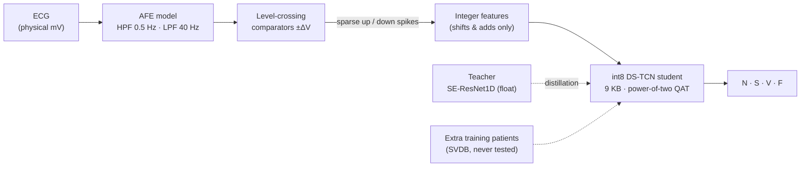

# Isoline: full experiment log

This is the complete, round-by-round lab notebook behind the [README](../README.md), including every negative result
and every DS2 evaluation. It is kept verbatim for transparency. Paths are relative to the repository root.

## Headline results (DS2, unseen patients, inter-patient De Chazal split)

| Model | Size | Accuracy | Macro-F1 | V F1 | S F1 | Compared with |
|---|---|---|---|---|---|---|
| **Isoline round 4 + AF detector** | ~46–64 KB + 5.1 KB | **95.64 ± 0.04 %** | 0.604 | **0.956** | 0.32 | clean re-run of the 96.14 % RF paper: 95.39 % (full-rate ECG) |
| **Isoline tiny + AF detector** | 5.2 + 5.1 ≈ **10.3 KB** | **94.81 ± 0.04 %** | 0.604 | **0.947** | 0.32 | LUT/logic-gate networks (2026): 93.6–94.4 %, V F1 ≤ 0.91, ~16 KB est. |

Both run on sparse level-crossing events (~90 % idle) instead of a sampled waveform. The AF detector uses RR intervals
only and was trained on the MIT-BIH AF Database + DS1 rhythm labels. All choices were made on DS1 or other databases.
DS2 has been evaluated 11 times over the project, each time on a configuration frozen beforehand. That count is
disclosed because it makes the comparison slightly optimistic. The best *reported* results on this split (≈96.15 %, full
waveform) are still ~0.5 points higher, and S detection (sensitivity ≈0.21) remains the main weakness.

## The idea

An ECG is mostly **nothing**. Between the QRS complexes the signal sits on the *isoelectric line* — the flat baseline —
for well over 80 % of every heartbeat. Conventional edge-AI runs a dense, frame-based network continuously across all of
it.

**Isoline** asks: what if a heartbeat is only *computed* when the signal actually moves?

A nanopower analog front end feeds a pair of **level-crossing comparators** that emit an `up` / `down` spike whenever
the conditioned ECG moves by ±ΔV. On a flat baseline there are no spikes, so nothing downstream needs a clock. When a
QRS arrives, a burst of spikes is turned into a small, **hardware-exact integer feature vector** and classified by a
**9 KB int8 network**.

> Why “Isoline”? The *isoelectric line* is the flat baseline of an ECG — exactly the part we refuse to spend energy on.

This repository is the **Python proof-of-concept** that answers the first question honestly: *how much accuracy do we
keep when the signal is reduced to sparse spikes, and what does it cost in sparsity and model size?*

## How it works



| Stage | What it does | Hardware-friendly because… |
|---|---|---|
| **AFE emulation** | Causal 1st-order HPF + 2nd-order LPF, then a delta modulator (±ΔV) | models the INA333 → comparator chain; no look-ahead |
| **Spike histograms** | 32-bin temporal histograms of up/down spikes over a 256-sample beat window | 8-bit saturating counters |
| **Leaky integrator** | 12-bit state, 8-bit output, sign-magnitude decay (`acc -= acc >> 4`) | one adder and a shifter |
| **Causal RR timing** | Q3.5 fixed point (1 s = 32 counts), EWMA by shifts, ratios | tiny timer + one divide per beat |
| **Gain adaptation** | Histograms shifted by a priority-encoder on the spike-energy EWMA | removes patient-to-patient amplitude bias |
| **Per-patient template** | Running average of *this patient's* recent normal beats; model sees `beat − template` | strictly causal, 96 small registers |
| **Student** | Dilated depthwise-separable TCN, BN folded, int8, power-of-two scales | every requantisation is a shift |

## Results

Everything below is **inter-patient**: train on DS1 patients, test on completely unseen DS2 patients (De Chazal split,
MIT-BIH, AAMI classes, paced records excluded).

### Final result (5 seeds, DS2 evaluated once per seed on a frozen config)

| | Accuracy | S F1 | V F1 | F F1 |
|---|---|---|---|---|
| Teacher (float, dense window) | 87.9 ± 2.0 % | 0.10 | 0.71 | 0.02 |
| Student (float) | 93.2 ± 0.8 % | 0.20 | 0.89 | 0.00 |
| **Student (int8 QAT, 9,072 B)** | **93.7 ± 0.4 %** | **0.17 ± 0.02** | **0.89 ± 0.01** | **0.00** |

**89.7 % idle sparsity** (≈ 55 spikes/s on average) at ΔV = 0.1 mV.

### Round 2: INCART as extra training patients (5 seeds, DS2 once, frozen config)

Adding the INCART database (75 records, training only, never tested) helped the gradient-boosting probe on DS1 CV
(accuracy 93.70 → 94.70 %, S F1 0.26 → 0.42) and was frozen as a design choice from that evidence plus a DS1-only dev run.

| int8 student, DS2, 5 seeds | Accuracy | Macro-F1 | S F1 | V F1 | F F1 |
|---|---|---|---|---|---|
| Round 1 (MIT-BIH DS1 only, distilled) | **93.7 ± 0.4 %** | 0.507 | 0.167 ± 0.022 | 0.891 ± 0.014 | 0.002 |
| Round 2 (+ INCART, no teacher, macro-F1 selection) | 92.3 ± 1.3 % | **0.530 ± 0.011** | **0.270 ± 0.026** | 0.868 ± 0.044 | 0.024 |

It is a trade, not a win: S F1 rises by about 0.10 and macro-F1 by 0.02, but accuracy falls 1.4 points and V gets slightly
worse. Neither run reaches the 95.5 % gate or the ~96 % literature ceiling.

### What moved the needle


The biggest single gain came from the **causal per-patient template**: judging each beat against that patient's own
recent normal beats lifted DS1 grouped-CV accuracy from ~91 % to 93.7 %. Adding a second database purely as extra
*training* data (SVDB) lifted `S` F1 from 0.26 to 0.32.

### Sparsity is nearly free


Raising ΔV from 0.05 to 0.2 mV pushes idle sparsity from 82 % to 94 % for roughly half a point of accuracy.

## Honest assessment

This is a working baseline, **not a state-of-the-art result**.

* ✅ Sparsity target met cheaply; 9 KB model; reproducible, leak-free, stable across seeds.
* ✅ `V` (ventricular) detection is decent (F1 ≈ 0.89).
* ❌ **`S` is weak** (F1 ≈ 0.17, sensitivity ≈ 0.11) and **`F` is essentially not detected.**
* ❌ Accuracy 93.7 % misses the 95.5 % target. For scale: about 89 % of DS2 beats are normal, so *always predicting
  “normal” already scores 89.0 %*. Per-class F1 is the number to watch.
* ❌ The distillation teacher is **worse** than the student; it is not yet pulling its weight.

**Negative results we kept:** a one-beat decision delay (using the *next* RR interval) barely helps
(93.70 → 93.75 %) and breaks causality, so it is off by default; extra RR-history features didn't help either.

**Open question that matters most:** the original thesis that *clock-gating the inference burst saves power* is
**unproven** — on an FPGA, static idle power dwarfs compute energy. The compute platform is intentionally undecided
until this PoC is finished. See [`docs/STATUS.md`](STATUS.md).

## Where the ceiling is (and what did not move it)

Credible published inter-patient results on the same De Chazal split top out around **96.1–96.2 % accuracy**
(S F1 ≈ 0.69, V F1 ≈ 0.94; e.g. a weighted kernel ELM and a 6-feature random forest). Much higher numbers in the
literature (98–99 %) come from intra-patient / random-beat splits, one-vs-rest "accuracy", or are unverified, and are
**not comparable**. Those methods use full-rate waveforms and large models; Isoline sees only sparse level-crossing
events and fits in 9 KB, so we are about 2.4 points below that ceiling on accuracy and far below it on S.

Round 2 of experiments (DS1 grouped CV only, DS2 untouched; full table in
[`results/exp_ideas_log.txt`](../results/exp_ideas_log.txt)):

| Idea | DS1 CV accuracy | Verdict |
|---|---|---|
| baseline | 93.70 % | — |
| per-class score scaling (nested CV) | 92.72 % | worse |
| second ECG lead | 93.74 % | no gain |
| dense raw waveform instead of spikes | 92.94 % | worse: spikes + template carry the signal |
| rhythm-irregularity / previous-beat features | 93.71–93.75 % | within noise |
| multi-scale ΔV (0.05 + 0.1 + 0.2 mV) | 93.59 % | no gain |
| full SVDB for the neural student | ≈93.1 % (1 seed, dev hold-out) vs 94.8 % without | worse, not adopted |

Takeaway: with these hardware-feasible features the DS1 estimate saturates near 93.7–94 %. The S misses are concentrated
in a handful of records (e.g. 209) and the false alarms in noisy ones (e.g. 203), so more feature engineering on the
same signal is unlikely to close the gap; likely levers are more diverse training patients and per-beat morphology
detail that the sparse encoding discards.

### Round 4: per-patient clustering + boosted trees — **94.8 % on unseen patients**

Two causal, hardware-cheap additions moved the DS1 estimate above 95 %: a long-memory RR average (~1 min) and an
**online per-patient morphology clustering** (4 leader-clustered templates; each beat carries how common its shape is for
*this* patient and what RR timing that shape usually comes with). With INCART as extra training patients and a
gradient-boosted-tree classifier, the configuration was frozen on DS1 CV (95.03 %) and evaluated once on DS2
([`scripts/final_gbt.py`](../scripts/final_gbt.py), [`results/final_gbt.json`](../results/final_gbt.json)):

| DS2, 5 INCART-subsample seeds | Accuracy | Macro-F1 | N F1 | S F1 | V F1 | F F1 | Model size |
|---|---|---|---|---|---|---|---|
| **Boosted trees (round 4)** | **94.76 ± 0.08 %** | **0.605** | 0.973 | 0.330 | **0.956** | 0.162 | ~46–64 KB est. |
| int8 student (round 1) | 93.7 ± 0.4 % | 0.507 | 0.967 | 0.167 | 0.891 | 0.002 | 9 KB |

V detection (Se 0.978, +P 0.935) is now at or above the best inter-patient V results we found in the literature.
**S remains the gap** (Se 0.28), and the model is larger than the original 12 KB budget (fine for MCU flash,
not for the original FPGA plan). Still about 1.2–1.4 points below the ~96 % literature ceiling.

*Disclosure:* this is the third time DS2 has been evaluated in this project (round 1, round 2, round 4), each on a
configuration frozen beforehand on DS1 only. Nothing was tuned after seeing a DS2 number.

### Reliability of the frozen 5.2 KB model

**Noise stress test** (MIT-BIH Noise Stress Test DB added to the DS2 records, EC57-style SNR, noise applied for the whole
record; [`results/noise_stress.json`](../results/noise_stress.json)):

| Noise | 24 dB | 12 dB | 6 dB | 0 dB |
|---|---|---|---|---|
| Electrode motion: V F1 / sparsity | 0.946 / 89.6 % | 0.918 / 87.9 % | 0.840 / 84.7 % | 0.716 / 77.9 % |
| Muscle artefact: V F1 / sparsity | 0.945 / 89.5 % | 0.936 / 86.4 % | 0.922 / 80.4 % | 0.883 / 70.6 % |
| Baseline wander: V F1 / sparsity | 0.948 / 89.7 % | 0.943 / 89.7 % | 0.944 / 89.5 % | 0.939 / 89.0 % |

(Clean: V F1 0.948, sparsity 89.7 %.) Baseline wander does essentially nothing (the HPF and the per-beat template absorb
it). Muscle noise mostly costs sparsity. Electrode motion is the worst case: below ~12 dB, V precision falls because noise
looks like ectopic beats. Overall accuracy is a poor metric here: it is dominated by N beats and can even rise as the
model calls fewer beats abnormal.

**Cross-database test** (trained on DS1 + INCART, nothing tuned; [`results/cross_db.json`](../results/cross_db.json)):

| Database | Beats | Accuracy | V Se / +P | S Se / +P | False alarms on normal beats |
|---|---|---|---|---|---|
| SVDB (supraventricular) | 184 k | 90.3 % | 0.92 / 0.51 | 0.15 / 0.66 | 4.1 % |
| European ST-T (mixed leads) | 790 k | 94.8 % | 0.85 / 0.10 | 0.27 / 0.59 | 5.0 % |
| MIT-BIH Long-Term | 669 k | 92.6 % | 0.90 / 0.61 | 0.55 / 0.30 | 6.6 % |
| Normal Sinus Rhythm (healthy) | 1.73 M | 99.4 % | — | — | 0.63 % (~27 per hour) |

V *sensitivity* transfers well (0.85–0.92). Precision does not: on other databases, recorded with other leads and
equipment, 4–7 % of normal beats are flagged. On healthy subjects the false-alarm rate is 0.63 %. A deployed device would
need per-patient calibration or alarm smoothing (e.g. only report bursts). SVDB was used as a development set for
*other* candidates in rounds 5 and 8.

### C export (round-10 tiny system)

[`scripts/export_c.py`](../scripts/export_c.py) writes [`export/isoline_model.h`](../export/isoline_model.h): the 5.2 KB beat
classifier (integer thresholds, since every input is an integer) and the RR-only AF detector (float32), plus
`isoline_classify()`. Compiled with gcc, it was checked against scikit-learn on 226,746 DS1 + INCART beats (no DS2):

* float32 leaves: **100.0000 % identical** decisions (bit-exact reference)
* int8 leaves (deployment): 99.95 % identical (109 beats differ)
* as exported: beat model 8.5 KB, AF detector 8.5 KB (32-bit thresholds, explicit child indices). A tighter layout
  (16-bit thresholds, implicit left child) gives 5.2 KB for the beat model. The 95-byte AF detector from the shrink
  study can replace this one.

### Non-premature S beats: the documented blind spot

We searched the development databases for S beats whose RR interval is ≥ 0.9 × the dominant RR, i.e. not premature
([`scripts/find_nonpremature_s.py`](../scripts/find_nonpremature_s.py)): DS1 268, SVDB 2,064 (1,761 from one patient), LTDB 191,
INCART 21. On held-out patients, the model detects **0–1.5 %** of them. Adding SVDB to training raises this only on
other SVDB patients (to 15 %), while DS1 and LTDB get worse, so the change was rejected without a DS2 run
([`results/exp_nonprem_log.txt`](../results/exp_nonprem_log.txt)). Isoline finds S beats almost entirely by their timing.
Detecting non-premature S beats would need P-wave morphology that the 0.1 mV comparator discards (and a finer band
did not recover it). This blind spot accounts for most of the remaining gap to the best reported results.

### Round 11: robust RR + 95-byte AF detector (negative on DS2)

Three dev-only studies ([`results/`](../results)): (1) the AF detector shrinks to **95 bytes** (5 trees) with the same DS1 benefit
([`af_shrink_log.txt`](../results/af_shrink_log.txt)); (2) a finer P-wave comparator band (0.05 / 0.025 mV) does **not** help
S on SVDB and costs sparsity ([`exp_pwave_log.txt`](../results/exp_pwave_log.txt)); (3) RR features relative to the dominant
RR help on **both** dev sets (DS1 95.03 → 95.35 %, SVDB 90.16 → 91.55 %, SVDB S F1 0.14 → 0.25;
[`exp_robust_rr_log.txt`](../results/exp_robust_rr_log.txt)). Combined and frozen, they scored **95.25 %** on DS2
(round-4 size, primary one-beat-delay variant; causal 95.20 %; tiny 94.57 / 94.45 %), below round 10
([`results/final_round11.json`](../results/final_round11.json)). The no-flag accuracy is unchanged (94.78 %); the
smaller AF detector gives a smaller flag gain on DS2. This was the 12th DS2 evaluation. **Round 10 remains the best result.**
DS2's remaining S errors sit mostly in one patient whose S beats are not premature, and no development set we have
reproduces that pattern.

### Round 10: a learned AF detector instead of an irregularity threshold

The round-9 flag silenced S calls whenever the rhythm was irregular, which also hid real S beats in frequent-ectopy
rhythms. A small RR-only AF/AFL detector (previous 16 beats: irregularity, dominance of the usual RR, short/long
fractions, compensatory pairs; 60 trees, 5.1 KB) was trained on the MIT-BIH AF Database and DS1 rhythm labels, with
the two databases weighted equally ([`scripts/af_detector.py`](../scripts/af_detector.py)). It was chosen over the threshold flag by
dev-set accuracy ([`results/af_flag_dev_log.txt`](../results/af_flag_dev_log.txt)) and then evaluated once on DS2
([`results/final_af_detector.json`](../results/final_af_detector.json)):

| DS2, 5 seeds | Accuracy | Macro-F1 | S Se / +P / F1 |
|---|---|---|---|
| round 4, no flag | 94.76 % | 0.605 | 0.28 / 0.41 / 0.33 |
| round 4 + irregularity flag (round 9) | 95.49 % | 0.579 | 0.13 / 0.74 / 0.22 |
| **round 4 + AF detector** | **95.64 %** | **0.604** | 0.21 / 0.71 / **0.32** |
| tiny 5.2 KB + AF detector | 94.81 % | 0.604 | 0.22 / 0.56 / 0.32 |

### Round 9: irregular-rhythm flag on the round-4 model — **95.49 % on unseen patients**

The same causal flag (threshold re-chosen on DS1 leave-one-patient-out by beat accuracy: T = 0.08, DS1 95.33 → 95.61 %)
applied to the round-4 model ([`scripts/af_round4.py`](../scripts/af_round4.py), [`results/af_round4.json`](../results/af_round4.json)):

| DS2, 5 seeds | Accuracy | Macro-F1 | S Se / +P / F1 | V Se / +P / F1 | Input |
|---|---|---|---|---|---|
| **Isoline round 4 + rhythm flag** | **95.49 ± 0.05 %** | 0.579 | 0.13 / 0.74 / 0.22 | 0.978 / 0.935 / **0.956** | level-crossing events |
| Isoline round 4 | 94.76 ± 0.08 % | 0.605 | 0.28 / 0.41 / 0.33 | 0.978 / 0.935 / 0.956 | level-crossing events |
| Our clean replica of the 96.14 % RF paper | 95.39 ± 0.09 % | 0.635 | — / — / 0.63 | — / — / 0.89 | full-rate ECG |
| Reported: weighted kernel ELM / RF paper | 96.15 % / 96.14 % | — | F1 0.69 / — | F1 0.94 / — | full-rate ECG |

From sparse comparator events, Isoline now matches a clean re-run of the best published method on accuracy, and beats it on V.
It is still about 0.65 points below the published 96.15 %. **The gain is a trade:** fewer false S alarms (S precision
0.41 → 0.74) but more missed S beats (sensitivity 0.28 → 0.13), so macro-F1 drops. The flag is a deliberate
"don't call S during AF-like rhythm" policy. This is the tenth DS2 evaluation in the project; the threshold was set on DS1.

### Irregular-rhythm flag and episode alarms (5.2 KB model)

A causal irregular-rhythm flag (median |ΔRR| / median RR over the previous 16 beats > T) re-labels S predictions as
normal during AF-like rhythm. T = 0.08 and the episode thresholds were chosen on DS1 leave-one-patient-out only
([`scripts/alarms.py`](../scripts/alarms.py), [`results/alarms.json`](../results/alarms.json)).

| | Beat accuracy before → after flag | S episode alarms: Se / +P / false alarms per hour | V episode alarms: Se / +P / FA per hour |
|---|---|---|---|
| DS2 | 93.27 → **94.57 %** | 0.61 / 0.61 / 5.0 (was 10.9/h per beat) | 0.98 / 0.88 / 3.3 |
| DS2 + electrode motion 6 dB | 92.70 → 93.22 % | 0.59 / 0.65 / 4.0 | 0.99 / 0.67 / 11.7 |
| MIT-BIH Long-Term | 92.62 → 92.83 % | 0.51 / 0.77 / 0.9 (was 7.0/h) | 0.99 / 0.84 / 8.5 |
| SVDB | 90.34 → 90.31 % | 0.43 / 0.89 / 1.9 | 0.99 / 0.75 / 10.7 |
| Normal Sinus Rhythm | 99.37 → 99.37 % | — / — / 2.4 | — / — / 5.3 |

The DS1 rule chose to report every predicted V beat (m_V = 1), so **V false alarms are not reduced**. They remain the
main weakness on other databases.

### Round 8: dev sets that disagree with DS2 (negative)

A variant chosen by a pre-stated rule (best mean of DS1 leave-one-patient-out and external SVDB accuracy;
[`results/exp_tiny_variants_log.txt`](../results/exp_tiny_variants_log.txt)) used MIT-only training, HPF 0.05 Hz, the
ported RR/QRS-width features and next-RR. It scored **92.65 %** on DS2, below round 7's 93.27 %
([`results/final_tiny2.json`](../results/final_tiny2.json)). Across rounds 4–8, neither DS1 CV nor SVDB ranked candidates
the way DS2 did. This was the ninth DS2 evaluation in the project. Further DS2-driven iteration would amount to
fitting the test set, so we stopped here. Real progress needs a development set that tracks DS2, or a fresh test set.

### Round 7: a 5.2 KB tree model

Size-capped boosted trees (30 rounds, 8 leaves, 5,160 B) on the round-4 features + INCART were chosen as the best
model of 9 KB or less by DS1 leave-one-patient-out (95.24 %; [`results/exp_tiny_gbt_log.txt`](../results/exp_tiny_gbt_log.txt))
and evaluated once on DS2 ([`results/final_tiny_gbt.json`](../results/final_tiny_gbt.json)):

| DS2, 5 seeds | Size | Accuracy | Macro-F1 | S F1 | V F1 |
|---|---|---|---|---|---|
| Tiny boosted trees | **5.2 KB** | 93.27 ± 0.05 % | ~0.60 | 0.31 | **0.947** |
| int8 CNN student (round 1) | 9 KB | 93.7 ± 0.4 % | 0.507 | 0.17 | 0.891 |

Smaller, and better on every rare class, for 0.4 points less accuracy. The 0.4-point drop on DS2 (the DS1 estimate was 95.24 %)
is another example of DS1 overestimating DS2. The 9 KB CNN student with round-4 features was not better on DS1 validation.

### Round 6: replicating the best published method under a clean protocol

We re-implemented the random-forest method reported at 96.14 % on this split (Saenz-Cogollo & Agelli, *Algorithms*
2020): MLII at 150 Hz, RR ratios against a 32-beat average, next-RR, QRS widths at fractions of the peak, Hermite
coefficients, MI ranking, 40-tree forest. That paper chose its feature count by looking at DS2; we chose it by
leave-one-patient-out on DS1 ([`scripts/replicate_rf.py`](../scripts/replicate_rf.py)). Some feature details are not
given in the paper and were approximated.

| DS2, 5 seeds | Accuracy | S F1 | V F1 | Signal |
|---|---|---|---|---|
| Dense replica, feature count chosen on DS1 | **95.39 ± 0.09 %** | **0.63** | 0.89 | full-rate ECG |
| (illustration: feature count chosen on DS2, paper-style) | 95.50 % | — | — | full-rate ECG |
| Same 8 features ported to comparator events (HPF 0.5 Hz) | 94.50 ± 0.13 % | 0.38 | 0.88 | level-crossing events |
| **Isoline round 4 (best pre-registered)** | 94.76 ± 0.08 % | 0.33 | **0.956** | level-crossing events |

Findings:
* In our replica, choosing the feature count on DS2 adds only ~0.1 points, so test-set tuning explains little of the
  paper's 96.14 %; the rest is probably feature details we could not reproduce.
* We traced the port's DS1 gap, without touching DS2, to two things: the width baseline (use the window mean, which is
  one accumulator in hardware) and the AFE's **0.5 Hz high-pass**, which distorts the QRS shape the widths are measured on.
  0.1 mV level-crossing quantisation itself costs nothing, and neither does the 1/32 s RR resolution. With a
  diagnostic-grade 0.05 Hz high-pass and a true 32-beat RR average, the event port matches the dense replica on DS1
  (95.02 % vs 95.23 % LOPO) at 89.1 % idle sparsity ([`results/diag_port_gap_log.txt`](../results/diag_port_gap_log.txt)).
* A rule fixed in advance chose among the event-domain candidates by DS1 LOPO accuracy. Round 4 won (95.33 % LOPO), and
  it already has a DS2 result, so no new DS2 run was made.
* 5-fold and leave-one-patient-out differ by about 1.3 points on DS1 for the same model, so comparisons only make sense
  under one protocol.

### Round 5: two-stage + S boost — a negative result on DS2

A second stage that remembers the first stage's predictions per patient cluster, plus a 6× boost on the S score, was
chosen to maximise mean accuracy over **two** development sets (DS1 grouped CV and external SVDB patients; DS2 sealed)
and then frozen ([`scripts/final_stage2.py`](../scripts/final_stage2.py)). On DS2 it **lowered** accuracy to
**93.00 ± 0.34 %** (S sensitivity 0.28 → 0.41 but S precision fell to 0.28). The development sets did not predict DS2's
S behaviour. Round 4 (94.76 %) remains the best result. This was the fourth DS2 evaluation in the project; further
DS2 looks would increasingly amount to test-set selection, so none were taken after it.

### Round 3: data mixes, model size, finer bins (DS1 grouped CV only; DS2 untouched)

| Probe (gradient boosting) | DS1 CV accuracy | S F1 | V F1 | F F1 |
|---|---|---|---|---|
| MIT-BIH DS1 only | 93.70 % | 0.26 | 0.81 | 0.00 |
| + INCART (N subsampled to 40k) | 94.78 % | 0.45 | 0.81 | 0.08 |
| + INCART + SVDB | 94.67 % | 0.40 | 0.83 | 0.04 |
| + INCART + EDB | 94.60 % | 0.42 | 0.82 | 0.15 |
| + INCART + SVDB + EDB | 94.83 % | 0.41 | 0.84 | 0.12 |
| + INCART, 3× bigger model (500 trees, 63 leaves) | 94.94 % | 0.43 | 0.82 | 0.07 |
| + INCART, 2× finer histogram bins (4 samples) | 94.82 % | 0.43 | 0.81 | 0.09 |

Every variant lands at **94.6–94.9 %**. Neither more data sources, a much larger model, nor finer bins moves it, so with
this sparse level-crossing representation the ceiling on this split looks like ~95 %, about one point under the
best published ~96 % (which uses full waveforms). Reaching 96 % honestly will need a change in what the front end
keeps (e.g. P-wave / morphology detail), not more tuning of this pipeline. See [`results/`](../results) for the logs.

## Research integrity

* **DS2 is the test set — never used for tuning.** ΔV, features, loss and early stopping are all chosen on DS1
  (record-grouped CV or a record-wise hold-out). `train_student.py` only touches DS2 with an explicit `--final`.
* **No patient leakage.** Splits are by record; extra databases are training data only.
* **Physical millivolts, no per-window z-score** — real comparators work on fixed voltage thresholds.
* **Causal features only** (pre-RR; no look-ahead beyond the beat window).
* **Seeds and error bars**, not best-of-N.
* **Disclosure:** the very first sweep looked at DS2 when picking ΔV = 0.1 mV. It was re-derived on DS1 only and agrees;
  the old files live in [`results/archive_first_run/`](../results/archive_first_run) and should not be cited.

## Quick start

```bash
pip install -r requirements.txt
python -m pytest -q tests                      # 9 tests on the integer feature logic
python scripts/download_data.py --only mitdb svdb

# 1) pick the level-crossing step on DS1 only
python scripts/select_delta.py --data-dir data/mitdb

# 2) develop on DS1 validation (DS2 is not even loaded)
python scripts/train_student.py --delta 0.1 --svdb-dir data/svdb --seeds 0

# 3) final, frozen-config evaluation on DS2
python scripts/train_student.py --delta 0.1 --svdb-dir data/svdb --seeds 0 1 2 3 4 --final

python scripts/make_figures.py                 # regenerate the plots above
```

**GPU (e.g. RTX 50-series, Blackwell):** install a CUDA 12.8+ build — `pip install torch --index-url
https://download.pytorch.org/whl/cu128`. `train_student.py` picks CUDA automatically. Installing `numba` makes the
feature loops ~50× faster.

## Repository map

| Path | Purpose |
|---|---|
| [`isoline/`](../isoline) | library: `afe.py`, `features.py` (integer feature logic), `pipeline.py`, `models.py`, `quant.py`, `data.py` |
| [`scripts/`](../scripts) | download, ΔV selection, training, diagnostics, SVDB experiment, figures |
| [`tests/`](../tests) | unit tests for the hardware-exact parts |
| [`results/`](../results) | final JSON/logs, DS1 experiments, per-seed checkpoints, archived first run |
| [`docs/STATUS.md`](STATUS.md) | **where we left off and what to do next** |
| [`docs/HANDOFF_original.md`](HANDOFF_original.md) | the original project brief |

## Roadmap

- [x] Dataset loader in physical mV, 360 Hz timebase, leak-free De Chazal split
- [x] AFE emulation + level-crossing encoder, ΔV selection on DS1 only
- [x] Hardware-exact integer features (+ per-patient template, gain normalisation)
- [x] Distilled int8 student with BN folding and power-of-two QAT, multi-seed evaluation
- [x] Extra training data (SVDB) shown to help `S` in DS1 CV
- [ ] Re-train the deep student with SVDB on GPU and re-run the frozen DS2 evaluation
- [ ] Fix the teacher; ablation table; size sweep; tree-ensemble baseline
- [ ] Literature baselines re-run under the same split; cross-dataset test
- [ ] Energy-per-beat estimate vs a duty-cycled MCU → **then** choose the compute platform
- [ ] Integer reference forward + `.hex` export, then hardware (custom PCB, designed by hand)

## License

MIT — see [`LICENSE`](../LICENSE).

## Round 12: S beats (option 1: S-biased operating point; option 2: P-wave features, round 2)
**Why S is stuck:** DS2's S beats are dominated by record 232, where most S beats are not premature. DS1 holds only 268 non-premature S beats (records 209 and 207 mostly) and INCART 21, so there is almost nothing to learn P-wave-based S from.

**Option 2 (rejected):** `scripts/exp_pwave2.py`, results in `results/exp_pwave2_log.txt`.
- **Features:** ten hand-made, patient-normalised P features from R−278 to R−61 ms (peaks, timing, correlation and distance to the patient's running P template).
- **P sources:** the STM32 ADC waveform (upper bound; A0 already carries the AFE output), and fine level-crossing bands at 0.05 and 0.025 mV.
- **Rule** (fixed beforehand): non-premature S Se must improve on ≥2 of DS1 CV / SVDB / LTDB, with no accuracy loss on any.
- **Result:** non-premature S Se stayed at 0–1.2% everywhere, and DS1 accuracy fell 1–2 points. The P features did cut false S on LTDB (S +P 0.13 → 0.42), but they do not find the missing beats. With this training data, P-wave information does not unlock non-premature S.

**Option 1 (kept as an optional mode):** `scripts/exp_sbias.py` chooses b, `scripts/final_sbias.py` runs the DS2 check.
- **Rule** (fixed beforehand): class = argmax(p · [1, b, 1, 1]), b maximising DS1 grouped 5-fold OOF macro-F1, with the AF detector retrained per fold.
- **Chosen:** full b = 20 (the grid was extended on DS1 after the first grid peaked at its edge), tiny b = 8.
- **DS2 look #14**, frozen, 5 seeds, deployed 0.05 Hz config:

| DS2 | Accuracy | Macro-F1 | S Se | S +P | S F1 | S Se excl. 232 | Non-prem. S Se | V Se / +P |
|---|---|---|---|---|---|---|---|---|
| Full, b = 1 | 95.51 ± 0.13 | 0.616 | 0.207 | 0.679 | 0.317 | 0.421 | 0.073 | 0.971 / 0.932 |
| Full, b = 20 | 94.52 ± 0.25 | 0.614 | 0.268 | 0.370 | 0.310 | 0.569 | 0.095 | 0.943 / 0.961 |
| Tiny, b = 1 | 94.76 ± 0.11 | 0.597 | 0.217 | 0.583 | 0.316 | 0.483 | 0.065 | 0.965 / 0.926 |
| **Tiny, b = 8** | 94.18 ± 0.23 | **0.617** | **0.374** | 0.422 | **0.396** | 0.582 | **0.238** | 0.939 / 0.949 |

On DS1 the bias raised accuracy as well; on DS2 it costs 0.6–1.0 points (DS2 has more normal beats with irregular RR, which pick up false S). For the tiny model the trade is worth having: S Se +16 points and S F1 +0.08 for −0.58 accuracy. For the full model it is not.
**Firmware:** `-DISO_S_BIAS_LOGIT=2.0794415f` (ln 8; one addition per beat). Default is off.
**Virtual HIL, DS2**, same frozen config (part of look #14): end-to-end 92.80% (vs 93.49%), S Se 38.9% (vs 23.6%), S +P 38.6% (vs 52.1%).
