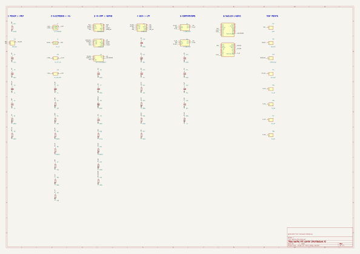

# Isoline hardware

Status: **design + simulation**. Nothing has been built yet.

## Analog front end (proposal) and its ngspice check

```
electrodes ─► INA333 (G=10, 50 µA) ─► ×30 gain (TLV8541) ─► 40 Hz Sallen-Key LPF (TLV8541) ─► 2 comparators ─► MCU
                 ▲ REF                                                                       (±30 mV steps)
                 └── DC servo integrator (TLV8541, 10 MΩ / 330 nF → 0.05 Hz high-pass)
```

* Total gain 300, so a 0.1 mV input step is **30 mV at the comparators**, which clears the TLV3691's ±17 mV hysteresis.
  At gain 100, a 10 mV step would be swallowed by the hysteresis. This is a design constraint the simulation-only model did not show.
* High-pass at **0.05 Hz**: the algorithm study showed that a 0.5 Hz corner distorts QRS shape and costs accuracy.
* `sim/make_afe_sim.py` writes `sim/afe.cir`, runs ngspice on a real MIT-BIH segment (record 101, with a 100 mV electrode
  offset) and compares the circuit with the Python AFE model used for every accuracy number:

| check | result |
|---|---|
| waveform correlation (input-referred, after 2 s) | **0.993** |
| RMS difference | **25 µV** (a quarter of one 0.1 mV comparator step) |
| level-crossing events, circuit vs model | **433 vs 435 (−0.5 %)** |
| output swing | 0.30 – 1.99 V on a 0–3 V supply (headroom OK) |

* **Known issue:** at power-up the 0.05 Hz servo takes several seconds to cancel electrode offset, and the gain stage
  saturates meanwhile. The simulation starts the servo pre-charged, and the board needs a fast-restore switch (the AD8233
  integrates one). That is a design to-do.
* Op amps are behavioural models (gain, GBW and rail limits from datasheets). Vendor SPICE models should replace them before tape-out.

### Classification accuracy through the simulated circuit

`sim/eval_circuit_accuracy.py` runs all 22 DS2 records through the circuit. ngspice computes the small-signal response
of the netlist and rail clipping is applied (validated against the full transient run: r = 0.99995, 439 vs 433
events). The round-10 system then classifies the result. Models are trained on DS1 + INCART with the Python AFE set to
the circuit's 0.05 Hz high-pass. Nothing is tuned; this is a measurement ([`results/circuit_accuracy.json`](../results/circuit_accuracy.json)).

| DS2, 5 seeds | Python AFE model | **ngspice circuit** |
|---|---|---|
| full model + AF detector | 95.51 ± 0.13 % | **95.50 ± 0.11 %** |
| tiny 5.2 KB + AF detector | 94.76 ± 0.11 % | **94.74 ± 0.06 %** |
| idle sparsity | 89.6 % | 89.6 % |
| output clipping | – | 0 % |

Not yet modelled: comparator offset and hysteresis, electrode noise, and beat detection from events (all accuracy
numbers here use annotated R-peak positions, as is standard on this benchmark).

See [POWER_BUDGET.md](POWER_BUDGET.md) for the power analysis and the architecture decision it raises.

## KiCad schematic

`kicad/isoline_afe.kicad_sch` is a native schematic generated by `kicad/make_schematic.py` from the same circuit
description. Every pin has a wire stub and a net label, grouped in six titled blocks. **Validated:** KiCad exports a
netlist from this schematic that is identical, net for net, to the generated netlist (31 nets). Open `isoline_afe.kicad_pro`,
tidy the placement if you like, then *Tools → Update PCB from Schematic*. KiCad 8/9 will upgrade the KiCad-7-format file
on save.



## KiCad: board netlist (generated from the same `design.py` as the simulation)

`kicad/make_netlist.py` → `kicad/isoline_afe.net` (56 parts, 31 nets, all footprints from the standard KiCad
libraries) and `kicad/bom.csv`. The board is a **carrier for a NUCLEO-L432KC** (Cortex-M4F with an on-board
ST-LINK), so there is no QFN to hand-solder and no separate programmer to buy.

**Import:** KiCad PCB Editor → *File → Import → Netlist…* → select `isoline_afe.net` → *Update PCB*.
Run the DRC after placement.

| Block | Parts | Notes |
|---|---|---|
| Power | 2×AAA holder (Keystone 2468), JP1 power select | JP1 1-2 = battery, 2-3 = Nucleo 3V3 from USB (development) |
| Reference | 2×1 MΩ divider + TLV8542 (U3B) buffer | VREF = VCC/2 |
| Input | J1 electrodes (RA−, LL+, RL), 10 k series, 10 MΩ bias to VREF | RL to VREF through 10 k |
| HIL input | J2 + 1 µF + 100 k / 100 Ω attenuator (~1/1000), JP2/JP3 | fit JP2 + JP3 **only** when injecting MIT-BIH from a DAC/audio out |
| In-amp | INA333 (U1), RG = 11.1 k (0.1 %) → G = 10 | pinout checked: RG 1/8, IN− 2, IN+ 3, V− 4, REF 5, OUT 6, V+ 7 |
| Servo / fast restore | TLV8542 U2A integrator 10 MΩ / 330 nF; SN74LVC1G66 switch + 100 k | MCU D6 (PB1) high for ~1 s at power-up |
| Gain + LPF | U2B ×30; U3A Sallen-Key 40 Hz (100 k, 100 k, 56 n, 27 n) | total gain 300 |
| Comparators | 2 × TLV3691 (SC70-5): UP = AFE > TH_UP, DN = AFE < TH_DN | thresholds from DAC PA4 (A3) / PA5 (A4); events to D2 (PA12) / D3 (PB0) |
| Debug | AFE_OUT → A0 (PA0) through 1 k; 8 test points | |

**Nucleo jumper note.** On the Nucleo-32, A4/A5 share pins with D4/D5 through solder bridges, so PA5 is input-only by
default. Open the relevant bridges (SB16/SB18 per UM1956) before using PA5 as DAC output, and check the exact bridge
numbers for your board revision in UM1956.

### Layout guidance (for you in KiCad)

1. **Two zones:** analog (J1, input resistors, U1, U2, U3, U6) on one side, Nucleo headers and comparators on the other.
   Use one solid ground pour on the bottom layer and do not split it.
2. **Keep high-impedance nodes tiny:** the servo node (SERVO_IN: 10 MΩ + 330 nF) and the 10 MΩ bias resistors. Use short
   traces, no vias if possible, and keep them away from the comparator outputs and the Nucleo. Consider a guard ring tied to VREF.
3. **Symmetric input routing** from J1 to U1 pins 2/3 (equal length, side by side) for CMRR.
4. **One 100 nF decoupling capacitor per IC**, placed right at its V+ pin. Put the 10 µF bulk capacitor near JP1.
5. **Comparators next to the Nucleo header**, so the fast-edged EV_UP / EV_DN traces stay short and far from the analog zone.
6. The 330 nF servo capacitor should be a low-leakage film or C0G/X7R part (leakage sets the corner frequency).
7. Header spacing: CN3 to CN4 = 15.24 mm (600 mil), pin 1 of both at the same end (USB end of the Nucleo).

### Before ordering a PCB: checklist

- [ ] Re-check every footprint against the exact ordered part (package suffix: INA333AIDGK, TLV8542ID, TLV3691IDCK, SN74LVC1G66DCK).
- [ ] Confirm the Nucleo-32 header order and solder bridges in UM1956 for your board revision.
- [ ] Replace the behavioural op-amp models with TI's SPICE models and re-run `sim/make_afe_sim.py`.
- [ ] Simulate the fast-restore start-up (switch on 1 s, then off).
